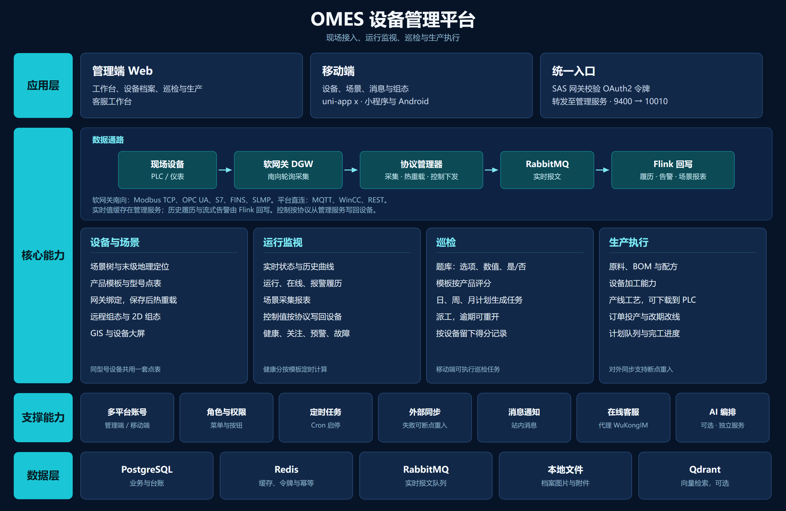

# OMES IOMP 工业设备管理平台

面向工业设备管理，提供设备接入、实时采集、点检、生产计划、工艺管理和 AI 辅助能力。采用 Apache-2.0 许可证，见 [LICENSE](LICENSE)。



## 模块与文档入口

公共环境、后端启动和 Docker 说明统一维护在本文；模块文档维护各自的配置和操作细节。

| 模块 | 职责 / 文档 | 默认端口 |
| --- | --- | --- |
| `omes-iomp-runner-admin` | 聚合业务模块的管理 API，主类 `com.ourexists.omes.AdminApp` | 10010 |
| `omes-iomp-runner-sas` | OAuth2 认证与 API 网关，主类 `com.ourexists.omes.sas.SasApp` | 9400 |
| `omes-iomp-runner-control` | 设备控制进程，主类 `com.ourexists.omes.control.ControlApp` | 10015 |
| [omes-iomp-web-admin](omes-iomp-web-admin/README.md) | Vue 管理端：开发、构建、网关配置。产品介绍见 [管理端介绍](管理端介绍.md) | 5173（开发） |
| [omes-iomp-app](omes-iomp-app/README.md) | uni-app x 移动端：运行与接口配置 | 9990（H5 开发） |
| [omes-iomp-ai](omes-iomp-ai/README.md) | AI 编排、模型供应商与部署配置 | 10011 |
| [omes-iomp-flinker](omes-iomp-flinker/README.md) | Flink 流处理（设备 / 场景，处理与两种启动） | — |

业务模块由运行模块集成，无需逐个启动：

| 模块 | 业务职责 |
| --- | --- |
| `omes-iomp-device` | 设备、产品、网关、场景及采集数据 |
| `omes-iomp-inspection` | 点检计划、任务、模板和记录 |
| `omes-iomp-mat` | 物料与 BOM |
| `omes-iomp-line` | 产线与流程 |
| `omes-iomp-process` | 工艺与配方 |
| `omes-iomp-mo` | 生产工单 |
| `omes-iomp-mps` | 主生产计划 |
| `omes-iomp-ucenter` | 账户、角色和权限 |
| `omes-iomp-message` | 消息与通知 |
| `omes-iomp-task` | 定时任务 |
| `omes-iomp-sync` | 数据同步 |

业务域内的 `model`、`feign`、`server` 分别承载模型、调用接口和服务实现；部分模块另有 `base` 公共层。实际依赖以各模块 `pom.xml` 为准。

## 环境与构建

- 后端使用 JDK 21、Maven。Flink 设备/场景作业字节码目标为 17，集群用 JDK 17、Flink 1.20.1；本机 `java -jar` 可用 JDK 17 或 21。
- 场景 Flink 编译目标为 Java 17，集群使用 JDK 17、Flink 1.20.1。处理模块与两种启动模块分开，详见各模块文档。
- 管理端 Node.js 要求见其 README 和依赖锁文件；移动端使用 HBuilderX 工具链。
- 默认数据库为 PostgreSQL，另需 Redis、RabbitMQ。
- 根 POM 依赖 `com.ourexists.era:era-parent:2024.0.2.0-SNAPSHOT`，相对路径为 `../era/pom.xml`。构建前需准备 Era 源码或可解析的私有制品源；仅克隆本仓库无法保证直接构建运行。

认证服务已包含在本仓库中，无需初始化子模块。以下命令均在仓库根目录执行：

```bash
# 构建管理 API 和认证网关及其依赖
mvn -pl omes-iomp-runner-admin,omes-iomp-runner-sas -am clean package -DskipTests

# 全部 Maven 模块
mvn clean package -DskipTests
```

前端依赖安装和构建见各自模块文档。`-DskipTests` 用于跳过测试，不代表测试已通过。

## 本地配置与启动

Admin / SAS 分别通过 `@PropertySource` 读取 `config/admin.properties`、`config/sas.properties`（可从同名 `*.example` 复制）；AI 仍读 `config/config.properties`。运行工作目录设为仓库根目录，并准备其中的数据库变量：`db_host`、`db_schema`、`db_username`、`db_password`。

认证相关配置放在 `config/era-token.yml`；中间件及服务变量以各服务 `config/*.properties` 为准（Docker Compose 不再注入这些键），默认值也可对照各运行模块的 `src/main/resources/application.yml`。本地配置不纳入版本控制。

| 配置 | 用途 |
| --- | --- |
| `REDIS_HOST`、`REDIS_PORT`、`REDIS_PASSWORD` | Redis 连接 |
| `RABBITMQ_HOST`、`RABBITMQ_PORT`、`RABBITMQ_USERNAME`、`RABBITMQ_PASSWORD`、`RABBITMQ_VHOST` | RabbitMQ 连接，采集服务与流处理作业需保持一致 |
| `OMES_GATEWAY_PORT` | SAS 监听端口，默认 9400 |
| `OMES_ADMIN_URL` | SAS 转发的 Admin 地址 |
| `OMES_INTERNAL_SERVICE_KEY` | Admin 与 SAS 内部调用密钥，两端保持一致 |
| `AI_BRIDGE_INTERNAL_KEY` | AI Bridge 内部调用密钥 |

分别启动 Admin 与 SAS（文件名以实际构建产物为准）：

```bash
java -jar omes-iomp-runner-admin/target/omes-iomp-runner-admin-1.0.1-SNAPSHOT.jar
java -jar omes-iomp-runner-sas/target/omes-iomp-runner-sas-1.0.1-SNAPSHOT.jar
```

然后按 [管理端说明](omes-iomp-web-admin/README.md) 启动前端。浏览器访问前端站点，认证和业务请求进入 SAS 网关，再由网关转发业务 API 至 Admin。SAS 不托管前端静态页面。

Control、AI 和两个 Flink 作业按业务需要启动。设备与场景 Flink 都支持内嵌 `java -jar` 和提交集群，用哪个包见对应模块说明。

## Docker 部署

所有 Dockerfile、Compose、Nginx 配置和部署脚本统一维护在 [docker 部署模块](docker/README.md)。构建路径已对齐仓库内的前端目录。

在仓库根目录执行：

```powershell
.\docker\docker.ps1 build
.\docker\docker.ps1 up infra
.\docker\docker.ps1 up
.\docker\docker.ps1 down
```

Linux / macOS 使用 `bash docker/docker.sh` 和相同子命令。脚本读取根目录 `.env`，首次使用从 [docker/.env.example](docker/.env) 生成；后端运行配置仍放在根目录 `config/`。网络要求、单独构建命令和目录说明见 [部署文档](docker/README.md)。

## 开源协议

本项目自有代码、文档和配置采用 [Apache License 2.0](LICENSE)（SPDX：`Apache-2.0`）。版权归属见 [NOTICE](NOTICE) 和各文件中的原始声明；第三方依赖、内置组件及另有声明的文件遵循各自许可证。

- 允许在遵守协议的前提下使用、修改、分发和商业使用。
- 分发本项目或其衍生作品时，应附带许可证副本、保留适用的版权和归属声明，并按协议要求保留 NOTICE 中的适用声明；修改过的文件应明确标注变更。
- 软件按现状提供，不附带担保；商标使用与专利授权的范围以许可证正文为准。

第三方组件说明见 [THIRD_PARTY_NOTICES.md](THIRD_PARTY_NOTICES.md)，提交贡献前请阅读 [CONTRIBUTING.md](CONTRIBUTING.md)。本节仅作说明，具体条款以 [LICENSE](LICENSE) 为准。
## 交流与支持

- 微信：m15026681077
- 邮件：434713950@163.com
- 项目介绍：https://blog.ourexists.site/2026/01/30/omes/
