# OMES 管理端

OMES 管理端是工业设备全生命周期管理平台的 Web 控制台。它要解决的不是「多几个列表」，而是把现场设备和生产安排放进同一条链：

1. 用场景把泵站、车间、产线分成可定位的现场。
2. 用产品型号规定采什么、怎么报警、怎么控制，用网关把 MQTT、PLC 等协议接进来。
3. 设备档案把场景、型号和网关绑在一起，运行侧才能看到实时值、下发控制、回看历史。
4. 巡检按产品出模板、按周期出任务；生产按配方、设备能力和产线工艺下订单，再排进队列执行。

## 优势

**一套档案走完全程。** 场景、产品型号、网关和设备只建一次。实时监视、地图、组态、巡检范围和生产订单都引用这套档案。换型号的采集地址或更换网关时，不用把每台设备的点表重写一遍。

**点和控制跟着型号走。** 属性、报警条件、控制量在产品上定义，采集地址在型号上填写。同型号设备批量接入，单台设备只决定落在哪个场景、走哪条网关。画面、告警、健康扣分和向下写入用的是同一组点。

**值班能定位，事后能回放。** 工作台看规模和未读告警，大屏给调度室，GIS 按末级场景落到地图，组态看现场画面。单台设备可以写入控制值，并回看最长 30 天的曲线。运行、在线、报警分开留档；同步中断后可以断点重入，不必整段重传。

**运维按规则排优先级。** 巡检题库按产品组成模板并打分，计划按每日、每周或每月加上场景自动出任务，逾期任务可以重开。健康分把报警次数、持续时长、运行率、在线率、使用年限和启停次数合成健康、关注、预警、故障，用来决定先修哪一台。

**订单在下发前就对上设备和控制器。** 配方写清原料占比，设备能力按原料写容量，产线工序写时长、温度和 PLC 映射，并可以下载到 PLC。生产订单把这三项收成批次，投产后再排队。改期、改线、增减数量时能看到会影响哪些批次。

**权限拆到岗位。** 管理端和移动端分成不同平台，角色控制菜单和按钮。巡检人员可以关联已有账号，或单独开账号到现场填报，配置和执行不必共用一个管理员。

## 应用场景

**分散泵站与液位监视。** 适用于镇、村、小区和道路沿线的泵站：每站若干水泵加液位计，地理上分散，协议多为 MQTT。场景树按镇、村分层，末级站点标注经纬度。调度在 GIS 和大屏上看哪一站离线或高液位，点进实时卡片看液位，需要时写入控制值。液位计和水泵按各自的产品模板做周期巡检。管理端里的演示数据就是这种形态。

**车间运行监视与计划点检。** 适用于单车间或一条产线。车间建成场景，设备挂上产品型号和网关。班组用工作台看在线趋势和告警，设备工程师用健康分安排检修顺序。点检员接收按日、周、月生成的任务，到场填写选项、数值或是否，系统按规则算出本次得分，管理人员回看逾期和低分设备。

**按配方和批次组织的加工。** 适用于有原料配比、工序节拍，并且工艺要下到 PLC 的产线。先维护原料和配方，再给设备按原料配置加工容量，把工序的温度、时长和内存映射编进产线工艺并下载。计划员下生产订单时选定配方、设备能力和工艺，投产后在看板上调整队列顺序，跟踪正在生产和已经完成的批次。

**多现场统一监管。** 适用于一个单位管理许多地理上分开的站点或车间。调度中心用大屏看全局，各现场人员只看到自己的菜单。地图密钥、消息推送周期和定时任务在系统配置里统一维护，告警可以按周期推到指定平台。

本地开发地址是 [http://localhost:5173](http://localhost:5173)。默认账号 `admin` / `admin123`，登录时把滑块拖到右侧。菜单按账号权限显示，没有权限的页面和按钮不会出现。

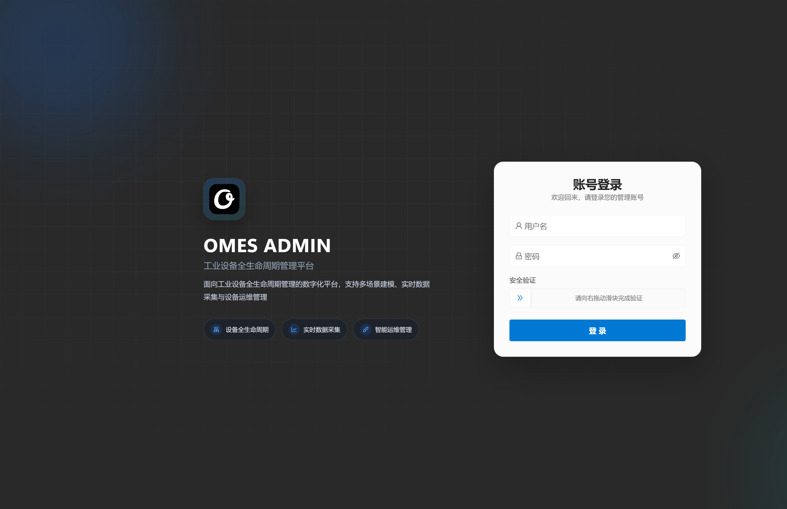

## 运行一览

登录后的工作台回答值班时的三个问题：现在有多少设备、状态是否正常、有没有没处理的告警。

数据概览给出设备总数、在线、离线、告警、运行、停止。数据分析用状态分布和近 7 日在线趋势看是瞬时掉线还是持续离线。告警动态列出报警标题和内容，可标记已读。右上角按场景筛选，不选就是全部现场。

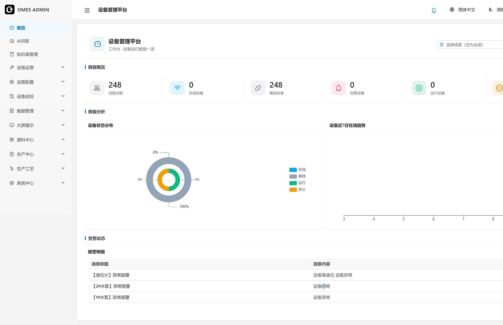

设备大屏把同一套数据做成监控中心，适合投到值班室。除计数和占比外，还有地图点位、平均健康评分（健康、关注、预警、故障）、近 7 日和当日趋势，以及按提示、警告、严重分级的关键事件。点开地图上的场景可以看到该点的在线、运行、告警和实时属性。支持全屏。

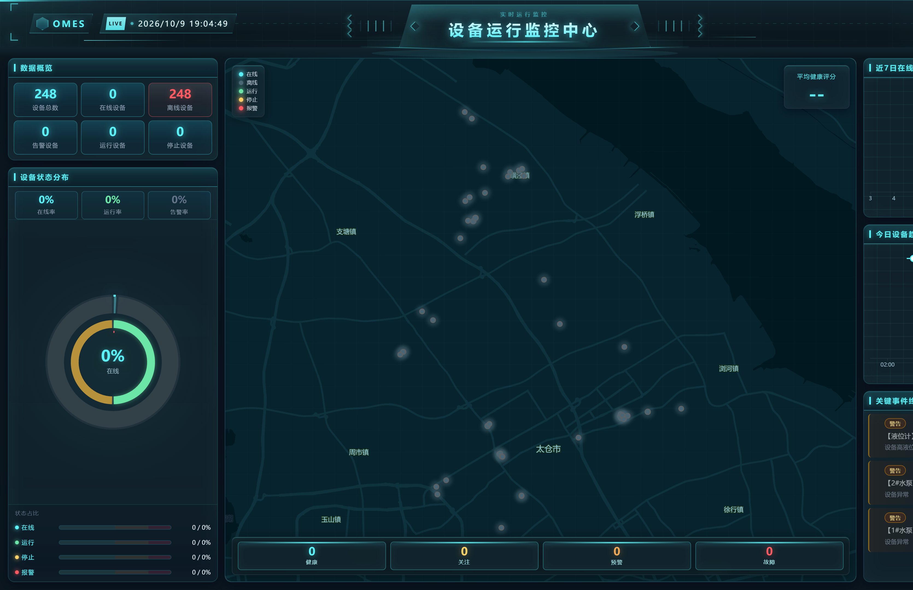

## 先建现场，再接设备

后面所有页面都挂在场景上。场景管理用树组织现场：分组节点用来分层，末级场景才是真正的现场。末级场景要填地址和经纬度，GIS 才会在这个点上画出该位置的全部设备。

每个场景还可以配三样东西，运行侧才会有画面和历史：

- **采集**：场景级采集项，每一项绑定网关、映射字段、单位和默认值。场景报表读的就是这里。
- **远程组态**：填写外部 SCADA 服务和画面编码，保存后得到可打开的组态地址，并可设置刷新间隔。
- **2D 组态**：在画布上画流程，把图元绑到场景采集项，预览时按间隔刷新实时值。

设备运营里的「场景组态」就是打开已经配好的远程画面。没配画面的场景打不开，需要先回到场景管理里补配置。

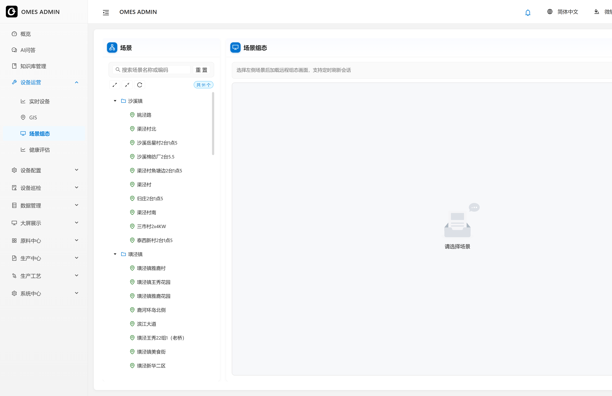

产品管理规定「这类设备长什么样」，避免每台设备各写一套点表。左侧是产品档案。产品上定义三类模板，模板里不含采集地址：

- 属性模板：要采集的量，例如液位、电流。
- 报警模板：条件、阈值和等级。
- 控制模板：允许下发的控制量、范围和单位。

右侧是该产品下的型号。型号才填写采集地址映射。同一产品的不同型号可以有不同映射；已经被设备引用的型号不能删。

设备网关是协议连接，不是某台设备。连接支持 MQTT、PLC 轮询等，填写服务名、地址、主题、账号和采集 Cron。启用后由管理服务拉起采集，已启用的连接在保存后热重载。哪台设备走哪条连接，不在网关页绑定，而在设备属性里选择网关；网关页只能查看已绑定的设备。

设备资产把上面三件事合成一台设备：先选场景，再登记名称、编码，选择产品和型号，绑定网关，并可选健康评分模板。型号上的属性映射会带到这台设备，设备本身主要负责「落在哪个场景、走哪条网关」。地图选点依赖系统配置里的百度地图密钥。

以一个泵站场景为例，下面会同时出现液位计和水泵：它们类型不同，但可以共用同一个 MQTT 网关。

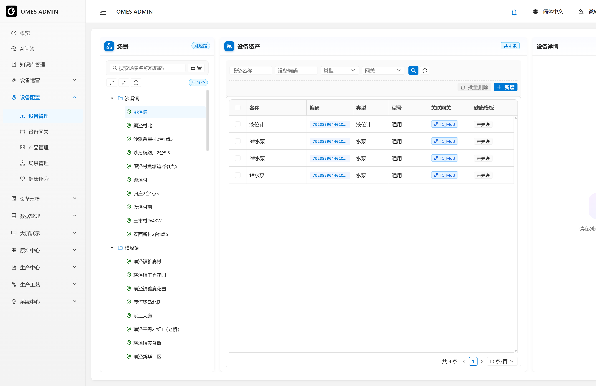

## 看运行、下控制、查历史

实时设备按场景把设备铺成卡片，持续刷新。卡片上的遥测来自产品属性模板，例如液位。顶部可按在线、离线、运行、停止、报警筛选。点进单台设备后分成四块：

- 设备信息：档案、位置、最后在线时间。
- 实时状态：开关量和模拟量的当前值；控制属性可以填写数值并写入设备。
- 数据图表：原始值，或按 30 分钟、小时、天、月聚合的均值、最小、最大。一次查询最长 30 天。
- 日志：运行过程记录。

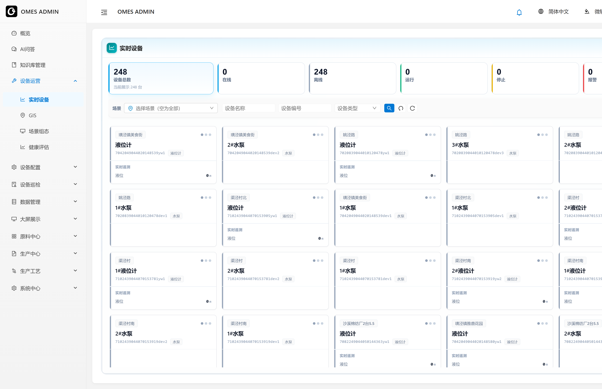

GIS 不按单台设备画点，而按末级场景的经纬度画点。点开一个位置，看到的是该现场全部设备的在线、运行和报警。没有经纬度的场景不会出现在地图上。

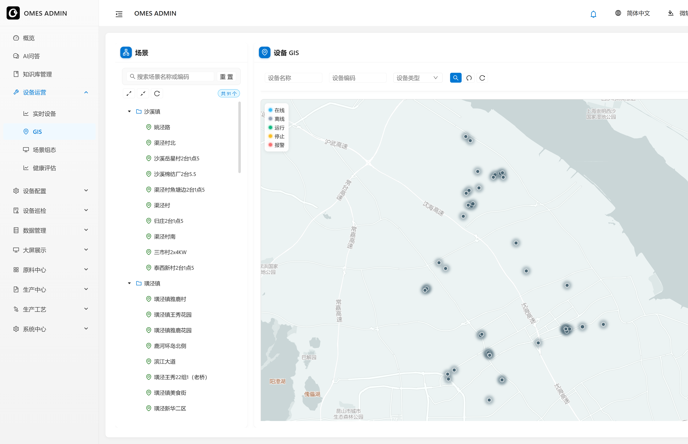

健康分用来把「偶尔报警」和「该修了」分开。健康评分里配置规则模板，统计窗口通常按小时，工业场景常用 24 小时。分数由四部分组成：报警次数和持续时长扣分，运行率、在线率按权重加分，使用年限、累计运行小时、启停次数超过阈值后再扣分。总分落在健康、关注、预警、故障四档。模板可以批量计算。健康评估按统计时间查询每台设备的得分、报警次数和运行、在线时长。设备档案里关联了模板，这台设备才会进入这套计算。

## 巡检

巡检不是再抄一遍设备台账，而是按产品把检查项变成可评分的任务。

1. **巡检项**是公共题库。题型有三种：选项、数值（可设上下限）、是/否。
2. **巡检模板**按产品分组，从题库载入检查项并设权重。评分按 100 分制：选项和是否是互斥匹配，数值按区间给分。没配规则时，正常得权重分，异常得 0 分。
3. **巡检计划**绑定一个模板，周期为每日、每周或每月，并指定场景；不选场景表示全部现场。启用后按周期自动生成任务，也可以手动生成。启用中的计划要先停用才能改。
4. **巡检任务**把待执行任务派给巡检人员。状态有待执行、执行中、已完成、已逾期。只有待执行的能派工，只有已逾期的能重新开始。
5. **巡检人员**登记姓名、工号和手机，可关联已有账号，或同步开一个登录账号。
6. **巡检记录**按设备留下本次得分、检查项结果和规则分，供事后追溯。

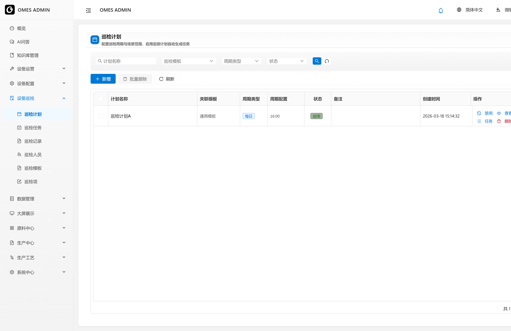

## 采集数据留下的记录

场景报表看的是场景采集项的历史，必须先在场景管理里配好采集属性，再选时间范围。设备状态记录则是单台设备的三本账：运行、在线、报警，可按设备编号和状态筛选。

数据同步查看分片同步事务：分片起止、状态、资源入参和异常。失败的事务可以断点重入，不必整段重传。任务管理是系统里的定时调度，用 Cron 启停后台任务，例如周期采集、评分和消息推送所依赖的时钟。

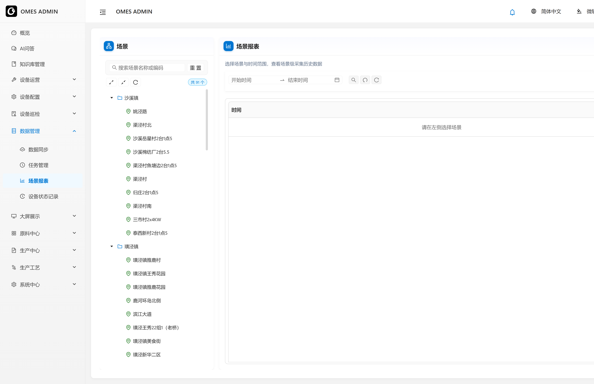

## 从原料排到设备上

生产侧接的是「做什么、用什么料、哪台设备能干、沿哪条工艺走」。

原料信息按分类管理原料档案。配方清单同样按分类管理，一份配方写清原料组成和占比，保存前占比要凑满。配方是生产订单的用料依据。

设备能力不是设备台账的重复。它是一套加工方案：从设备档案里绑定加工设备，再按原料分别写容量。同一台设备可以出现在不同方案里，容量只对当前方案有效。

产线工艺描述一条线怎么加工：加工对象、原材料、版本、单次产量和工序步进间隔。工序流程在画布上排节点和连线，节点带工艺时长、设定温度，以及映射内存、偏移量，用来对上 PLC。配好后可以把工艺下载到选定的 PLC 服务。列表上的同步时间和 PLC 下载时间用来确认这套工艺是否已经下到现场。

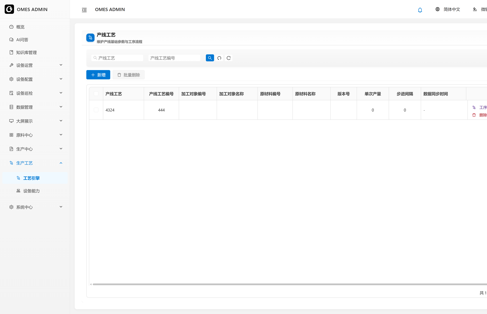

生产订单把配方、设备能力和产线工艺合成一张可执行的单。新建时分五步：订单编号和场景、配方及投料明细、总批次和预期执行时间、设备能力及投料设备、产线工艺及其工序。订单状态从待投产、部分投产、投产完成走到生产完成，也可以取消。

待投产且还没拆出子计划的是草稿，可以删。已经投产的单可以改期、改线、增量或减量；有批次正在执行时，取消必须强制并填写操作人。执行生产时选择一次性投产或部分投产，数量不能超过剩余批次，确认后生成生产计划。

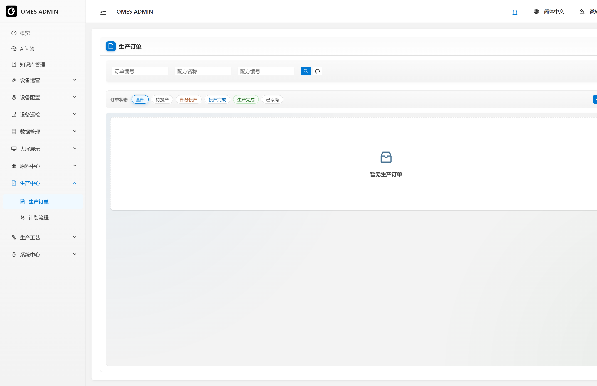

计划流程是投产之后的看板，从左到右三步：待排产里点「排入队列」，排队等待里调整先后（最上面最先做），生产进度里看正在做和已经做完的批次。

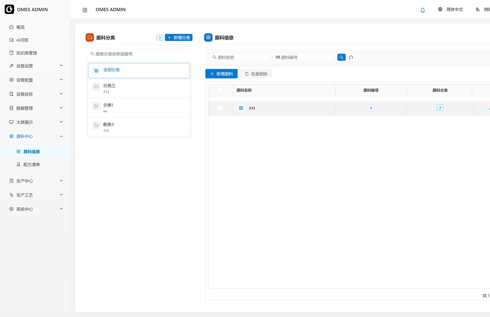

## 谁能看、系统怎么配

系统按平台分账号，例如管理平台和移动端。账户可以冻结、设有效期、分配角色。角色决定能看到哪些菜单和按钮。权限本身是一棵树，按平台维护，所以不同端的菜单可以分开配。

消息通知按周期向指定平台推送，消息分普通和告警。文件管理存放上传的图片和资料，产品和设备档案里的图片从这里来。系统配置用一份 JSON 保存全局参数，百度地图密钥就在这里，设备选点和 GIS 都依赖它。

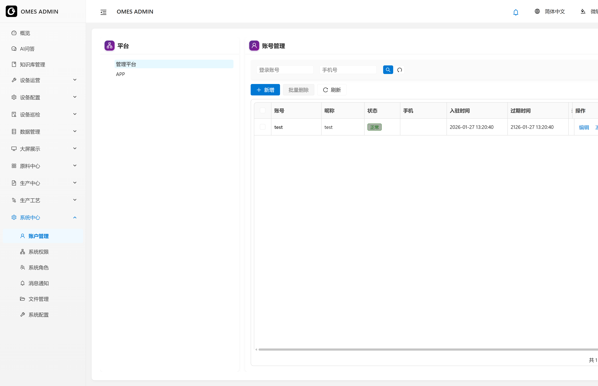

AI 问答和知识库管理是侧栏上的智能助手入口，用来查资料和针对现场问题提问，服务与管理端分开部署。
